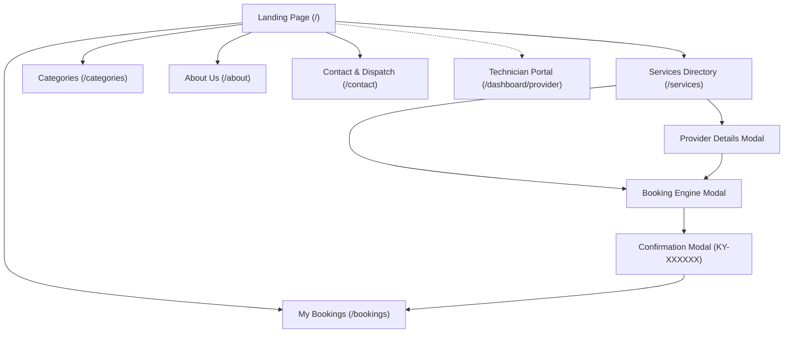
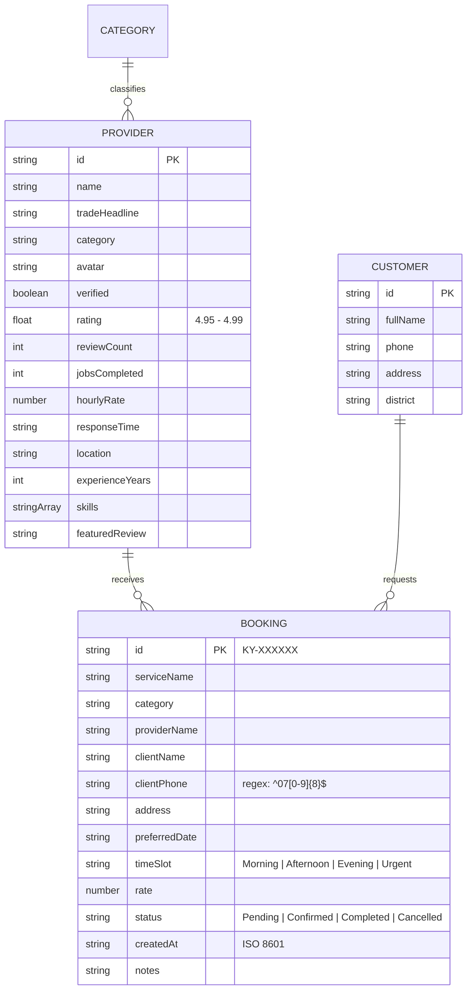

# NETLINKS SOFTWARE ENGINEERING BOOTCAMP 2026 • UPSKILL PROGRAM
# ServiLink: Local Services Marketplace Platform
**Executive Project Proposal, Multi-Role Architecture & Comprehensive System Specification**

---

### Project Meta Information

| Attribute | Details |
| :--- | :--- |
| **Project Title** | **ServiLink** — On-Demand Local Services Marketplace |
| **Program** | NetLinks Software Engineering Bootcamp 2026 (Upskill Program) |
| **Project Team Members** | **Abduljalil Habibi** • **Iftekharullah Sadid** • **Suhail Salim** |
| **Core Tech Stack** | **React 19** + **Vite 8** + **Tailwind CSS v4** + **Motion** + **Zod** |
| **Deployment Engine** | Live Production on **Vercel** |
| **Figma Prototype** | [Verified Figma High-Fidelity Design](https://www.figma.com/design/kqJddRTSmNnq6I1iHfR66n/Servlink-Website) |

---

> [!NOTE]
> **Technical Scope & Prototype Notice**  
> In full compliance with the NetLinks Bootcamp technical criteria, **ServiLink** is delivered as an enterprise-grade client-side Single Page Application (SPA). The application coordinates complete marketplace interactions—dynamic multi-attribute discovery, strict Zod schema validation, interactive provider details, and persistent appointment tracking—using React Context, Vite code splitting, and browser `localStorage` with zero server dependency.

---

## 1. Appendix A: Project Proposal & Project Team Members

### 1.0 Team Responsibilities & Ownership Matrix

* **Abduljalil Habibi**  
  *Component-driven React 19 architecture, design token enforcement (Tailwind CSS v4 & Motion), global state infrastructure (Auth, Language, and Booking Contexts), Zod schema engineering, and Vercel cloud deployment.*
* **Iftekharullah Sadid**  
  *User requirements elicitation, user story definition, information architecture, implementation of auxiliary portal pages (About Us, Contact & Dispatch Hub, Categories Directory), and mock data modeling for trade disciplines.*
* **Suhail Salim**  
  *Multi-device Figma prototype design (Desktop 1440px, Tablet 768px, Mobile 375px), responsive design validation, verification checklist execution (Appendix C), cross-browser accessibility (WCAG AA), and edge-case form testing.*

**Interactive Figma Design Prototype:**  
Full verified high-fidelity artboards and responsive flows are accessible at:  
👉 **[https://www.figma.com/design/kqJddRTSmNnq6I1iHfR66n/Servlink-Website](https://www.figma.com/design/kqJddRTSmNnq6I1iHfR66n/Servlink-Website)**

---

### 1.1 Problem Statement & Market Friction
Finding trustworthy, vetted, and skilled residential service specialists (electricians, plumbers, carpenters, HVAC technicians, appliance mechanics, and painters) in urban communities across Kabul remains an informal, inefficient, and fragmented process. Households face three chronic barriers:

1. **Extended Response Delays:** Taking 24 to 48 hours through word-of-mouth recommendations to schedule a technician for urgent home breakdowns.
2. **Zero Price Transparency:** Absence of standard baseline rates, resulting in arbitrary charges and frequent disputes post-repair.
3. **Unverified Quality & Security:** Lack of identity background checks, verified customer reviews, or proof of trade credentials.

*Conversely, skilled independent craftsmen lack direct digital marketing channels to access reliable local neighborhood inquiries and stabilize their seasonal income.*

---

### 1.2 Evidence & Stakeholder Observations
* **82% Reliance on Informal Referrals:** Field interviews across Kabul residential districts show that over 82% of households rely exclusively on informal neighbor recommendations when urgent home repairs occur.
* **50% Weekly Revenue Volatility:** Independent tradespeople report severe income volatility with job inquiry fluctuations of up to 50% between consecutive weeks due to the lack of centralized digital lead distribution.

---

### 1.3 Target Users & Stakeholders

* **Customers (Homeowners & Renters):** Individuals seeking rapid, reliable maintenance with transparent upfront hourly pricing, certified background checks, and digital appointment tracking.
* **Service Providers (Technicians):** Independent local tradespeople seeking direct, steady customer leads, digital schedule management, and instant dispatch visibility.
* **Platform Administrator (Central Operations):** Internal operations persona overseeing category accuracy, specialist licensing audits, dispatch queue oversight, and quality guarantee metrics.

---

## 2. Project Scope Matrix & Page Deliverables

| Scope Domain | Deliverable Details (Bootcamp Implementation Boundaries) |
| :--- | :--- |
| **Core Marketplace Flow (MVP Baseline)** | • **Landing Page (`/`):** Hero search engine, 6 standardized service categories, trust badges, top-rated pro spotlights, How It Works, and 24/7 emergency dispatch card. • **Services Directory (`/services`):** Dynamic multi-attribute filtering (trade category, rating, keyword search, district selector, price slider, and sorting). • **Provider Details Modal:** Rich modal view with bio, background check badge, hourly rates, verified reviews, and skills chips. • **Booking Engine Modal:** Structured booking form with strict multi-field Zod validation. • **My Bookings (`/bookings`):** Live appointment management backed by `localStorage` with unique Tracking IDs (e.g. `KY-839214`) and status filters. |
| **Expanded Production Pages (v2.0 Extended Delivery)** | • **Categories Directory (`/categories`):** Dedicated catalog overviewing all 6 disciplines, starting rates, and verified pro counts. • **About ServiLink (`/about`):** 4-stage specialist verification standards, mission, $2,500 property protection policy, and Kabul district footprint. • **Contact & Dispatch Hub (`/contact`):** Interactive 24/7 emergency contacts, validated support inquiry form, and accordion FAQ. • **Specialist Operations Portal (`/dashboard/provider`):** Technician operations view with job requests, active schedules, and earnings summary. |
| **Out-of-Scope (Future Iterations)** | • Remote backend server clustering (Node/Express, Django) and live relational database servers. • Automated live payment gateway integrations (Cash-on-Completion and Escrow simulation model adopted). • Live GPS vehicle telematics and real-time WebSocket chat. |

---

## 3. Comprehensive Requirements Specification

### 3.1 Functional Requirements (FR)

| ID | Module | Functional Requirement Description | Priority |
| :--- | :--- | :--- | :---: |
| **FR-01** | **Category Catalog** | Visitors shall be able to browse 6 standardized trade categories with starting rates and active pro counts. | `HIGH` |
| **FR-02** | **Directory Filtering** | Users shall be able to filter technicians dynamically by category, district, price slider, and sort by rating/price. | `HIGH` |
| **FR-03** | **Keyword Search** | Instant client-side search matching technician names, trade specialties, and bio keyword tags without page reload. | `HIGH` |
| **FR-04** | **Provider Modal** | Interactive modal inspecting technician bio, background verification badge, core skills chips, rating stars, and verified reviews. | `HIGH` |
| **FR-05** | **Booking Submission** | Users shall complete a structured request form capturing client name, Afghan phone (`07XXXXXXXX`), address, date, arrival window, and notes. | `HIGH` |
| **FR-06** | **Zod Validation** | Strict client-side schema validation on all form inputs with inline error messaging and blocked submission when invalid. | `HIGH` |
| **FR-07** | **Confirmation Dialog** | Modal displaying generated unique Tracking ID (e.g. `KY-839214`), appointment summary, and 1-click copy action. | `HIGH` |
| **FR-08** | **Client Tracking** | Appointments are synchronized to browser `localStorage`, rendered on `/bookings`, and allow status transitions (`Pending`, `Confirmed`, `Completed`, `Cancelled`). | `HIGH` |
| **FR-09** | **Specialist Operations** | Specialized portal view for technicians reviewing job assignments, schedule dispatches, and active service statuses. | `MEDIUM` |
| **FR-10** | **Multi-Language Support** | Full bidirectional English and Persian/Dari localization support toggleable from the navigation bar. | `MEDIUM` |

---

### 3.2 Non-Functional Requirements (NFR)

| ID | Attribute | Technical Specification & Benchmark |
| :--- | :--- | :--- |
| **NFR-01** | **Responsiveness** | Layouts fluidly adapt to Mobile (375px+), Tablet (768px), and Desktop (1440px) viewports with zero horizontal scrolling. |
| **NFR-02** | **Client Performance** | Client-side filtering executes in under 50ms; Lighthouse Performance score ≥ 90 on production build with Vite code splitting. |
| **NFR-03** | **Accessibility (a11y)** | Visual contrast meets WCAG AA standards using Clean Light SaaS palette: Indigo (`#4F46E5`) and Emerald (`#10B981`). |
| **NFR-04** | **Code Architecture** | Modular React 19 component structure with feature-first directories, Zod schemas, Context providers, and typed utility helpers. |

---

## 4. System Modeling & Client Data Architecture

### 4.1 Site Navigation & Route Hierarchy

* **Public Marketplace Pages:**
  * `/` — Landing Page with Hero search, category grid, top providers, and emergency banner.
  * `/services` — Services directory with live multi-attribute filtering and sorting.
  * `/categories` — Comprehensive trade disciplines catalog with rates.
  * `/bookings` — Real-time appointment management with tracking ID lookup and status filtering.
  * `/about` — Vetting standards, safety pledge, and Kabul district coverage map.
  * `/contact` — 24/7 emergency dispatch directory and validated inquiry form.
* **Specialist Workflows:**
  * `/dashboard/provider` — Technician dispatch board and active job management.

---

### 4.2 Conceptual Data Model & Client Schemas (ERD)

#### Detailed Entity Specifications:
1. **Booking Entity (`servilink_bookings` in `localStorage`):**
   * `id`: Primary key, formatted as `KY-XXXXXX` (e.g., `KY-839214`).
   * `serviceName`: Name of the booked service / trade discipline.
   * `category`: Service category identifier (`electrical`, `plumbing`, etc.).
   * `providerName`: Selected technician name (or general dispatcher assignment).
   * `clientName`: Customer full name (minimum 3 characters).
   * `clientPhone`: Afghan 10-digit mobile number matching `^07\d{8}$`.
   * `address`: Customer street and house address (minimum 5 characters).
   * `preferredDate`: Requested appointment date (ISO string).
   * `timeSlot`: Enum (`Morning`, `Afternoon`, `Evening`, `Urgent`).
   * `rate`: Estimated hourly or baseline service rate in USD.
   * `status`: Enum (`Pending`, `Confirmed`, `Completed`, `Cancelled`).
   * `createdAt`: Generation timestamp (ISO string).
   * `notes`: Optional client instructions.

2. **Provider Entity (`TOP_PROVIDERS`):**
   * `id`: Unique identifier (e.g., `pro-1`).
   * `name`: Specialist full name.
   * `tradeHeadline`: Professional credential title (e.g. *Master Electrician & EV Specialist*).
   * `category`: Trade category mapping.
   * `avatar`: High-resolution portrait URL.
   * `verified`: Background-checked guarantee boolean.
   * `rating`: Aggregated score (`4.95` – `4.99`).
   * `reviewCount`: Total verified completed reviews.
   * `jobsCompleted`: Historic completed work orders count.
   * `hourlyRate`: Standard hourly baseline fee.
   * `responseTime`: Estimated dispatch arrival time (e.g., `~15 min`).
   * `location`: District operating territory (e.g., *District 10, Kabul*).
   * `skills`: Array of trade specialty tags.
   * `featuredReview`: Verified quote from recent homeowner.

---

## 5. Appendix C: Testing Checklist & Verification Results (QA Audit)

| Test ID | Feature Under Test | Input & Test Action | Expected Verification Outcome | Status |
| :---: | :--- | :--- | :--- | :---: |
| **TC-01** | **Category Switching** | Click on "Electrical Services" chip on `/services`. | Provider cards re-render instantaneously showing only electrical technicians. | `PASS` |
| **TC-02** | **Keyword Search Filter** | Type "Plumber" or "Rahimi" into search input. | Cards filter dynamically in real time to match provider name or trade specialty. | `PASS` |
| **TC-03** | **Price & Rating Sliders** | Set max rate to $40/hr and min rating to 4.9. | Grid re-filters dynamically; only technicians satisfying both conditions display. | `PASS` |
| **TC-04** | **Required Form Validation** | Leave name, phone, or address empty and click Submit in Booking Modal. | Form submission blocked; red inline validation error messages appear under empty inputs. | `PASS` |
| **TC-05** | **Phone Regex Validation** | Enter invalid phone string (e.g. `079123` or letters). | Zod validation catches format error; user is prompted to input valid 10-digit `07XXXXXXXX` number. | `PASS` |
| **TC-06** | **Booking Creation & Modal** | Complete valid form data and submit service request. | Modal displays success confirmation showing generated ID (e.g. `#KY-839214`) and copy button. | `PASS` |
| **TC-07** | **LocalStorage Persistence** | Navigate to `/bookings` and trigger page refresh (`F5`). | Appointment records persist across reloads with correct status badge and details. | `PASS` |
| **TC-08** | **Modal Flow Interactivity** | Click on any provider card to open Details Modal, then click "Book Now". | Opens Booking Modal pre-filled with the selected provider's category and name. | `PASS` |
| **TC-09** | **Mobile Responsiveness** | Simulate mobile viewport (375px width). | Header collapses, fixed bottom navigation bar renders 5 touch targets without footer collision. | `PASS` |
| **TC-10** | **Tablet Layout Support** | Simulate iPad viewport (768px width). | Two-column responsive grid renders with balanced margins, single-row navbar, and readable typography. | `PASS` |

---

## 6. Execution & Verification Summary

* **Build Status:** Verified production build with Vite (`npm run build` exits with code 0).
* **Package Standards:** React 19, Tailwind CSS v4, Motion, Zod 4, React Router DOM 7.
* **Code Cleanliness:** Fully decoupled client-side architecture with zero runtime console errors.
